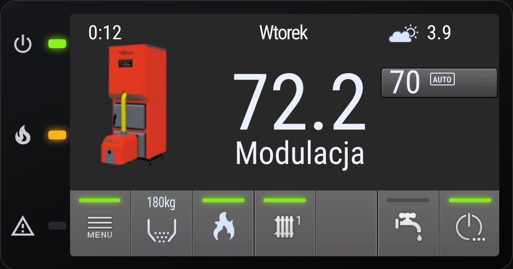
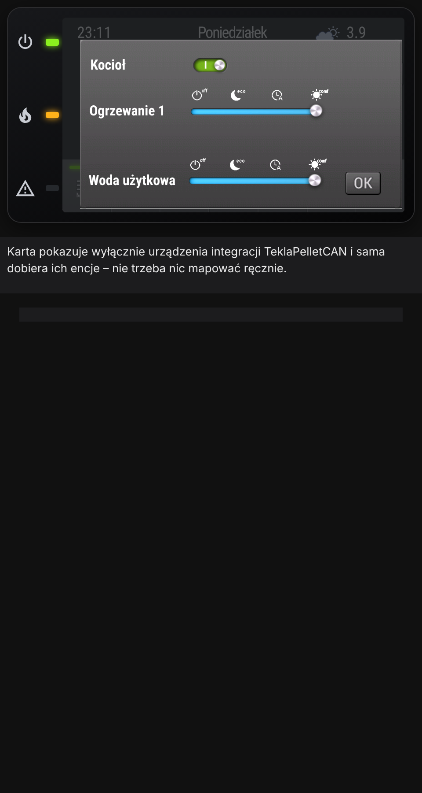
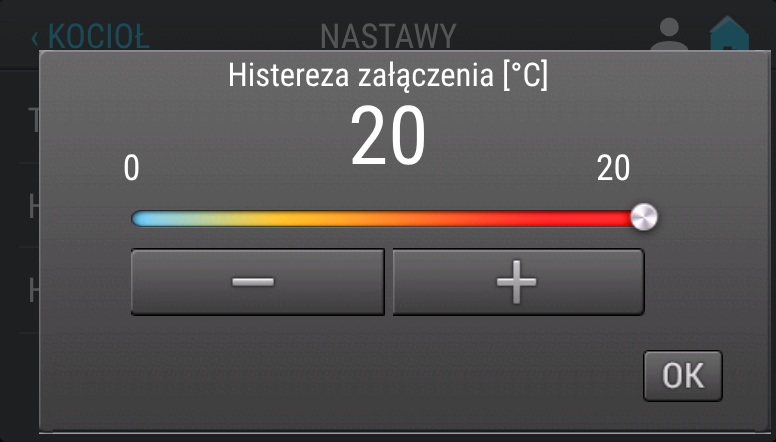

# TeklaPelletClassic-card

Karta Lovelace dla Home Assistant — wierna replika ekranu panelu dotykowego kotła Tekla/Estyma **Igneo Touch**,
zbudowana z oryginalnych bitmap panelu (ten sam wygląd co fizyczne urządzenie: kafelki, suwaki, przyciski,
diody). Współpracuje wyłącznie z integracją [TeklaPelletCAN](https://github.com/GieOeRZet/TeklaPelletCAN_HA).

<p>
  <br>
  
  
</p>

## Instalacja (HACS)

1. HACS → Frontend → ⋮ → Własne repozytoria → dodaj `https://github.com/GieOeRZet/TeklaPelletClassic-card`
   jako **Plugin** (jeśli repozytorium nie jest jeszcze w domyślnym katalogu HACS).
2. Zainstaluj, odśwież stronę przeglądarki (Ctrl+Shift+R — ważne, karta cache'uje się agresywnie).
3. Dodaj kartę na dashboardzie: typ **`custom:teklapelletclassic-card`**.
4. Jeśli masz tylko jedno urządzenie integracji TeklaPelletCAN w swoim Home Assistant — karta znajdzie je sama,
   bez żadnej konfiguracji. Przy kilku urządzeniach edytor karty pokaże listę do wyboru.

## Wymagania

- Zainstalowana i skonfigurowana integracja [TeklaPelletCAN](https://github.com/GieOeRZet/TeklaPelletCAN_HA)
  (karta sama niczego nie odczytuje z urządzenia — korzysta wyłącznie z encji i usług wystawionych przez
  integrację).
- Home Assistant ≥ 2024.12.0.

## Jak karta znajduje urządzenie (bez ręcznej konfiguracji)

W przeciwieństwie do starszych kart tego typu (`pelletcan-card`, zgadującej urządzenie po prefiksie nazw encji w
całym Home Assistant), ta karta wyszukuje urządzenie **przez rejestr urządzeń HA**
(`identifiers[0] === "teklapelletcan"`) — dzięki temu nie pomyli się z ESPHome ani inną integracją, nawet jeśli
masz wiele różnych urządzeń pelletowych podłączonych na raz. Prefiks encji dla znalezionego urządzenia jest
wyliczany automatycznie.

## Co można zrobić w karcie

Karta jest ekran po ekranie, przycisk po przycisku taka sama jak fizyczny panel Igneo Touch — wszystko, co da się
zrobić na panelu kotła, da się zrobić i tutaj:

- **Kocioł / Palnik / CO / CWU** — podgląd temperatur, zmiana trybu, nastawy (temperatura zadana, krzywa
  grzewcza), tak jak w menu panelu.
- **PROGRAM** — harmonogram tygodniowy (CO/CWU), identyczny układ pasków godzinowych jak na panelu.
- **Test wyjść** — test poszczególnych wyjść sterownika (dmuchawa, podajnik, pompy, mieszacze) — tylko od
  poziomu dostępu 2.
- **Alarmy** — historia alarmów kotła z potwierdzaniem.
- **Poziom menu (PIN)** — ten sam dwupoziomowy PIN co na panelu (0900/0999); poziom 1/2 odblokowuje dalsze opcje
  serwisowe bez wychodzenia z karty.
- **Tryb lite** (`lite: true` w konfiguracji YAML) — uproszczona wersja bez menu poziomów, do zastosowań typu
  "tylko podgląd/szybka zmiana trybu" na mniejszym dashboardzie.

## Konfiguracja karty (edytor wizualny)

| Opcja | Co robi | Domyślnie |
|---|---|---|
| Urządzenie | Wybór, gdy integracja wykryje więcej niż jedno urządzenie | pierwsze znalezione |
| Ekran startowy | Który ekran panelu pokazuje się po otwarciu karty | główny |
| Język | Język interfejsu | automatycznie (język Home Assistant) |
| Obraz kotła | Grafika pasująca do fizycznego modelu kotła (typy 11/12/13/14) | typ 13 |
| Pokaż obudowę | Zaokrąglona, czarna "obudowa" panelu z bocznymi diodami LED (jak na zdjęciu wyżej) — wyłączenie zostawia sam płaski ekran, bez ramki | włączona |

Wszystkie opcje ustawia się w edytorze wizualnym karty (bez pisania YAML), a zmiany od razu zapisują się do
konfiguracji karty w dashboardzie.

## Komunikacja — skąd karta bierze dane

Karta **nie łączy się bezpośrednio z urządzeniem ani z siecią CAN kotła**. Cała komunikacja idzie przez
standardowy mechanizm Home Assistant:

```
Karta (ta) ── hass.states[...] / hass.callService(...) ──▶ Home Assistant
                                                                 │
                                           integracja TeklaPelletCAN (REST/WebSocket)
                                                                 │
                                                        urządzenie ESP32-C6 ── CAN ── kocioł
```

Odczyty to zwykłe stany encji HA (odświeżane tak szybko, jak odświeża je integracja — zwykle przez WebSocket,
niemal natychmiast). Zapisy (zmiana trybu, temperatury zadanej, nastaw) to wywołania usług integracji
(`teklapelletcan.set_param`, `set_setpoint` itd.) — karta nigdy nie zapisuje niczego z pominięciem Home
Assistant i jego mechanizmów autoryzacji.

## Architektura (dla kontynuujących rozwój)

Ten plugin to jeden plik wejściowy (`teklapelletclassic-card.js`, jedyny zasób wymagany w dashboardzie), który
ładuje wspólny silnik renderowania (`teklapelletclassic-engine.js`) — ten sam silnik napędza też portal WWW
samego urządzenia i aplikację Android. Silnik działa przez **tekstowe patchowanie** niezmienianej bazy
`tekla-panel-card.js` (nie przez dziedziczenie klas) — pełny opis mechanizmu, pułapek CSS i mapy bitmap panelu:
patrz `DOKUMENTACJA/ARCHITEKTURA-KARTY-CLASSIC.md` i `DOKUMENTACJA/BITMAPY-PANELU.md` w repozytorium
[GieOeRZet/TeklaPelletCAN](https://github.com/GieOeRZet/TeklaPelletCAN) (tam powstaje kod źródłowy — to
repozytorium dostaje gotowe wydania dopiero przy publikacji).

## Zastrzeżenia

Grafiki panela pochodzą z oryginalnego oprogramowania Igneo Touch i są własnością Estymy (wszelkie prawa
zastrzeżone) — zostaną usunięte z repozytorium na wyraźną prośbę właściciela praw. Projekt niezależny i
nieoficjalny, niezwiązany z firmami Tekla ani Estyma.

## Licencja

Zobacz [LICENSE](LICENSE).
